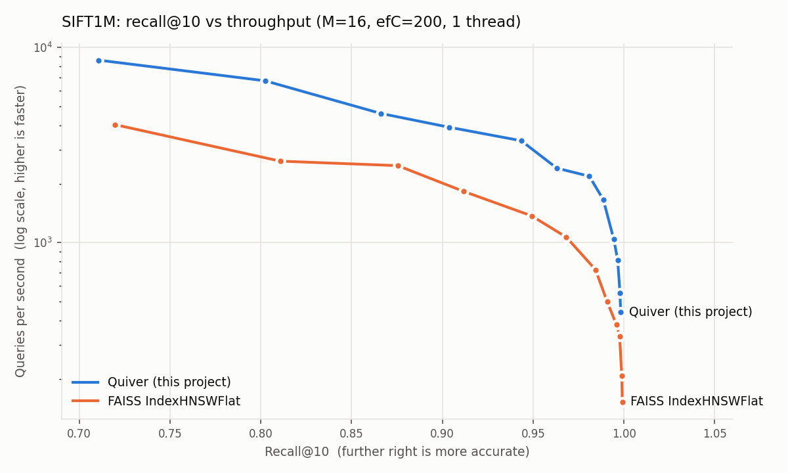
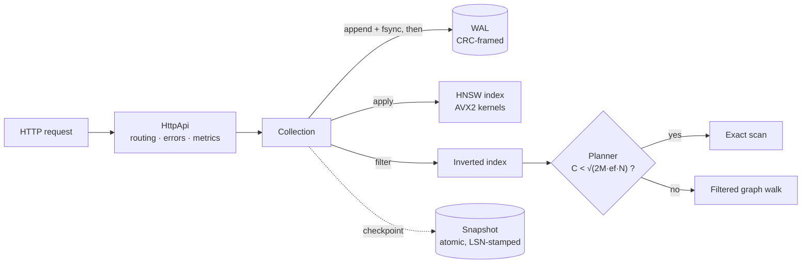

<div align="center">

# 🏹 Quiver

**A vector database written from scratch in C++17**

HNSW approximate nearest-neighbour search · SIMD kernels · crash-safe write-ahead log · cost-based filtered search · REST API

[](https://github.com/Lotr2/quiver/actions/workflows/ci.yml)


[](LICENSE)

</div>

---

Quiver stores embedding vectors with JSON metadata and answers *"which stored items are most similar to this one?"* in under a millisecond. That query is the retrieval step behind semantic search, recommendations and retrieval-augmented generation (RAG). It is the same kind of system as Pinecone, Milvus, Qdrant or pgvector, built here from first principles: no index or storage library, just the C++ standard library plus [cpp-httplib](https://github.com/yhirose/cpp-httplib) and [nlohmann/json](https://github.com/nlohmann/json) for the network layer.

<p align="center">
  
</p>

<p align="center"><sub>SIFT1M (1M × 128-d vectors), one search thread, same graph parameters for both engines. See <a href="#benchmarks">Benchmarks</a> for the method and its caveats.</sub></p>

## Highlights

- **HNSW index from the paper.** Hierarchical graph with the neighbour-diversity heuristic, re-pruning of full neighbour lists, tombstone deletes and a validated binary format. Recall matches FAISS's HNSW within about 0.01 at equal settings.
- **Fast on commodity hardware.** AVX2/FMA distance kernels chosen at runtime from CPUID (a portable scalar fallback runs on ARM), prefetching, and epoch-tagged visited sets so a query never pays an O(n) clear. On SIFT1M: **96% recall@10 at about 2,400 queries/s on one core** of a 2015 laptop CPU.
- **Parallel index construction.** Inserts run on all cores using 4,096 striped locks. No thread ever holds two locks, so deadlock is impossible by construction, and searches keep running during writes.
- **Crash-safe storage.** Every write batch goes to a CRC-framed write-ahead log before it is applied. Snapshots are replaced atomically and carry a log sequence number (LSN), which makes replay idempotent. Tests cut the log at every offset of a record and flip bits to prove recovery is all-or-nothing per batch.
- **Filtered search with a query planner.** An inverted index over metadata gives the exact candidate set. A cost model (`C < √(2M·ef·N)`) then chooses between an exact scan (100% recall for selective filters) and a filtered graph walk, and every response reports the plan it used.
- **Production basics.** REST API with typed errors, Prometheus `/metrics`, graceful shutdown with checkpointing, Docker image, Python client, 61 C++ tests plus end-to-end client tests, and CI on Linux, macOS and Windows with AddressSanitizer, UBSan and ThreadSanitizer.

## Quickstart

### Run with Docker

```bash
docker build -t quiver .
docker run -p 7070:7070 -v quiver-data:/data quiver
```

### Or build from source

Needs CMake ≥ 3.20 and a C++17 compiler (GCC, Clang or MSVC). Dependencies are fetched and pinned automatically.

```bash
cmake -S . -B build -DCMAKE_BUILD_TYPE=Release
cmake --build build --parallel
ctest --test-dir build --output-on-failure      # run the tests
./build/quiver-server --port 7070 --data-dir ./quiver-data
```

### Use it

```bash
# Create a collection of 4-dimensional vectors compared by cosine similarity
curl -X POST localhost:7070/collections \
  -d '{"name": "articles", "dim": 4, "metric": "cosine"}'

# Insert points with metadata (one request = one atomic batch)
curl -X POST localhost:7070/collections/articles/points -d '{"points": [
  {"id": "a", "vector": [1, 0, 0, 0],     "metadata": {"topic": "ml", "year": 2024}},
  {"id": "b", "vector": [0.9, 0.1, 0, 0], "metadata": {"topic": "db", "year": 2023}},
  {"id": "c", "vector": [0, 1, 0, 0],     "metadata": {"topic": "ml", "year": 2022}}
]}'

# The 2 nearest neighbours whose topic is "ml"
curl -X POST localhost:7070/collections/articles/search \
  -d '{"vector": [1, 0, 0, 0], "k": 2, "filter": {"topic": "ml"}}'
```

```json
{
  "hits": [
    {"id": "a", "score": 1.0, "metadata": {"topic": "ml", "year": 2024}},
    {"id": "c", "score": 0.0, "metadata": {"topic": "ml", "year": 2022}}
  ],
  "plan": {"strategy": "exact_scan", "candidates": 2, "distance_computations": 2},
  "took_ms": 0.07
}
```

### From Python

```python
from quiver_client import Quiver          # pip install ./clients/python

db = Quiver("http://127.0.0.1:7070")
docs = db.create_collection("docs", dim=384, metric="cosine", exist_ok=True)
docs.upsert({"id": f"doc-{i}", "vector": emb, "metadata": {"lang": "en"}} for i, emb in enumerate(embeddings))

for hit in docs.search(query_embedding, k=5, filter={"lang": {"$in": ["en", "de"]}}):
    print(hit.id, hit.score, hit.metadata)
```

[`examples/semantic_search.py`](examples/semantic_search.py) is a runnable end-to-end semantic search demo.

## API

| Method | Path | Body / notes |
|---|---|---|
| `GET` | `/health` | version and detected SIMD level |
| `GET` | `/metrics` | Prometheus text format |
| `GET` | `/collections` | list with sizes |
| `POST` | `/collections` | `{"name", "dim", "metric": "cosine"\|"l2"\|"ip", "M", "ef_construction", "ef_search", "sync": "fsync"\|"flush"}` |
| `GET` | `/collections/:name` | config, counts, WAL size, index stats |
| `DELETE` | `/collections/:name` | drop it and its files |
| `POST` | `/collections/:name/points` | `{"points": [{"id", "vector", "metadata"}]}`: upsert, atomic per request |
| `GET` | `/collections/:name/points/:id` | one point |
| `DELETE` | `/collections/:name/points/:id` | delete one point |
| `POST` | `/collections/:name/points/delete` | `{"ids": [...]}` |
| `POST` | `/collections/:name/search` | `{"vector", "k", "ef", "filter", "include_vectors", "include_metadata"}` |
| `POST` | `/collections/:name/checkpoint` | snapshot now and truncate the WAL |
| `POST` | `/collections/:name/compact` | rebuild the graph without tombstones |

**Filters** are an AND of fields, each matching a scalar exactly: `{"genre": "sci-fi", "year": {"$in": [1999, 2003]}}`. Matching is typed, so `1` does not match `"1"`.

**Scores**: for `cosine` and `ip`, higher means more similar. For `l2`, the score is the squared distance, so lower means closer.

**Errors** always look like `{"error": {"code": "invalid_argument", "message": "..."}}`, with status 400 (bad input), 404 (missing), 409 (already exists) or 500.

## Benchmarks

**Setup.** [SIFT1M](http://corpus-texmex.irisa.fr/): 1,000,000 base vectors and 10,000 queries, 128 dimensions, L2, recall@10 against the official ground truth. Both engines use M = 16 and ef_construction = 200. Hardware: Intel i7-6820HQ (4 cores / 8 threads, 2015 laptop), 16 GB RAM, Windows 10. Reproduce with `quiver-bench` and [`bench/compare_faiss.py`](bench/compare_faiss.py).

| ef_search | Quiver recall@10 | Quiver QPS (1 thread) | Quiver QPS (8 threads) | FAISS recall@10 | FAISS QPS (1 thread) |
|---:|---:|---:|---:|---:|---:|
| 32  | 0.904 | 3,901 | 22,041 | 0.912 | 1,830 |
| 64  | 0.963 | 2,409 | 12,836 | 0.968 | 1,067 |
| 128 | 0.989 | 1,662 |  7,342 | 0.991 |   498 |
| 256 | 0.997 |   812 |  3,495 | 0.998 |   332 |

| | Quiver | FAISS 1.14.3 `IndexHNSWFlat` |
|---|---:|---:|
| Index build, 1M vectors, 8 threads | **192 s** | 377 s |
| Index memory | 620 MiB | n/a |
| Median latency at 96% recall, 1 thread | **390 µs** | n/a |

**How to read this honestly:**

- **Recall is the like-for-like check.** At the same `ef`, both engines reach almost the same recall (FAISS is about 0.005 higher), which is what two correct HNSW implementations should do.
- **The throughput gap is mostly about this build of FAISS, not a better algorithm.** The FAISS numbers come from the `faiss-cpu` pip wheel on Windows, called from Python one query at a time for the single-thread column. A FAISS build compiled with AVX2 and called from C++ on Linux would close much of the gap. The fair claim is that Quiver is in the same performance class as a widely used production library on identical hardware.
- **This laptop's speed varies between runs** (thermal and power state). An earlier run of the same binary measured 5,479 QPS at 96% recall and a 127 s build. The table uses the slower run.

## Architecture



[`docs/architecture.md`](docs/architecture.md) covers the design in depth: the memory layout, the lock-striping argument for why inserts cannot deadlock, the WAL format and every crash window it handles, and the derivation of the planner's cost model.

## Testing

| What | How |
|---|---|
| **Kernel correctness** | dispatched kernels vs a double-precision reference for every dimension from 1 to 300 (all tail lengths); AVX2 vs scalar at edge sizes up to 1536 |
| **Search quality** | recall@10 ≥ 0.97 on clustered data; concurrent builds must match sequential builds |
| **Concurrency** | parallel inserts with concurrent searches and forced resizes; ThreadSanitizer in CI |
| **Crash recovery** | WAL cut at every 7th byte of the last record; bit flips; a crash between snapshot rename and WAL truncation; a corrupt snapshot must fail loudly |
| **Planner** | selective filters must use an exact scan, broad filters a graph walk, and both must return only matching points |
| **API** | an in-process server on an ephemeral port: status codes, error bodies, metrics, restart persistence |
| **Memory safety** | AddressSanitizer and UndefinedBehaviorSanitizer over the full suite |

Building with a second compiler (Clang) caught a real use-after-free in the filter parser that GCC's code had hidden; see [the fix](../../commit/b923413). That is why CI runs several compilers and sanitizers.

## Project layout

```
include/quiver/   public headers: index, collection, WAL, filter, distance
src/              core library (no network code)
server/           REST API, metrics, quiver-server entry point
tools/            quiver-bench (fvecs loader, recall/QPS sweeps)
tests/            GoogleTest suites, including in-process API tests
clients/python/   dependency-free Python client + tests
bench/            FAISS comparison and plotting scripts, raw results
docs/             architecture notes and figures
```

## Roadmap

- [ ] Scalar (int8) and product quantisation for 4–30× smaller indexes
- [ ] Group commit: one fsync shared by many concurrent writers
- [ ] Range filters (`$gt`, `$lt`) over a sorted secondary index
- [ ] WAL shipping to read replicas
- [ ] Batch search endpoint

## License

[MIT](LICENSE) © 2026 Mohamed Anan
