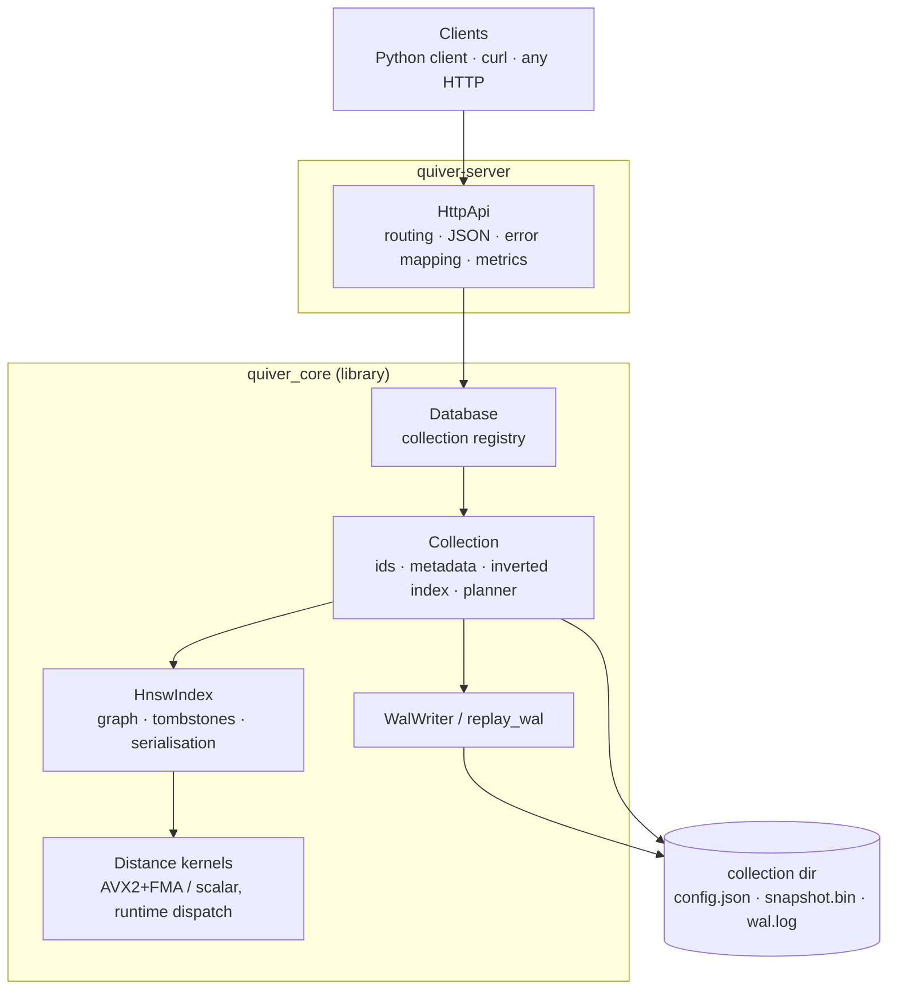
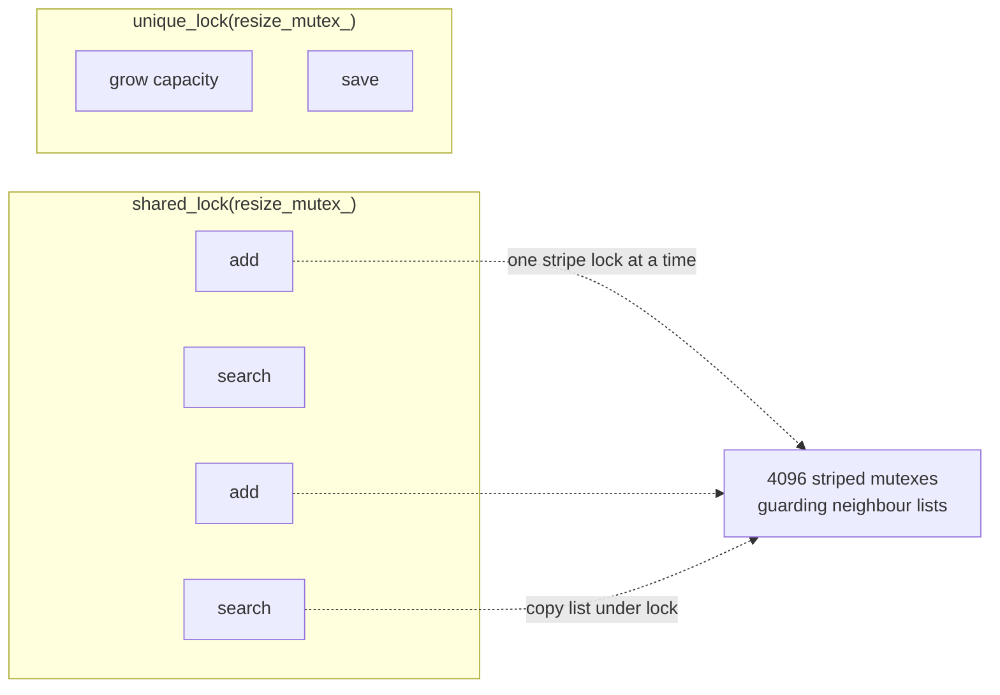
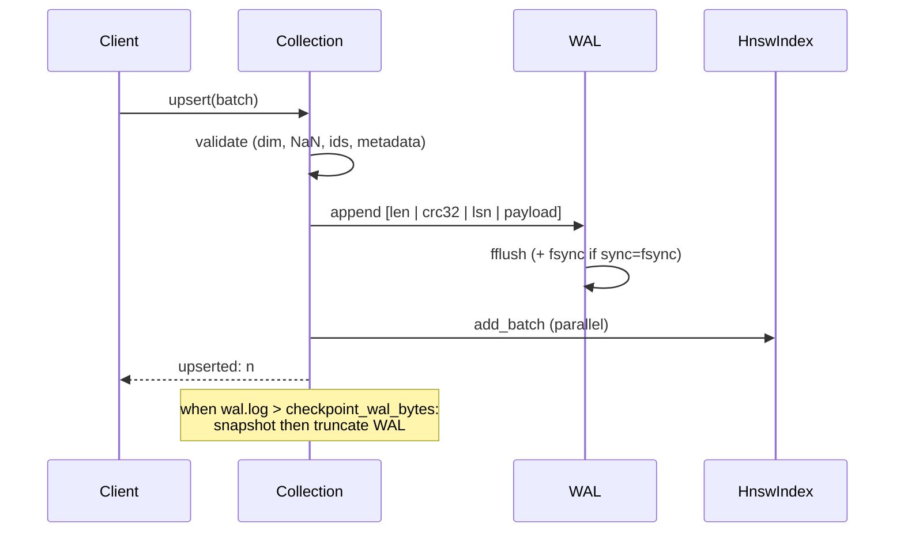

# Architecture

This document explains how Quiver is put together and why. It is written for someone who wants to read or change the code.

- [Layers](#layers)
- [The HNSW index](#the-hnsw-index)
- [Concurrency](#concurrency)
- [Durability: WAL, snapshots and recovery](#durability-wal-snapshots-and-recovery)
- [Filtered search and the query planner](#filtered-search-and-the-query-planner)
- [The HTTP layer](#the-http-layer)
- [Limitations and next steps](#limitations-and-next-steps)

## Layers



| Layer | Files | Responsibility |
|---|---|---|
| Distance kernels | `src/distance.cpp` | L2 and dot product, AVX2+FMA or portable scalar, picked once from CPUID |
| Index | `src/hnsw_index.cpp` | Approximate k-NN graph; knows only dense `node_id`s and float vectors |
| Collection | `src/collection.cpp` | String ids, JSON metadata, inverted index, WAL, snapshots, query planning |
| Database | `src/database.cpp` | Directory of collections; create / open / drop |
| HTTP API | `server/http_api.cpp` | REST routes, typed errors, Prometheus metrics |

The core library has no network code. The server is a thin layer over it, and the benchmark tool links only the core.

## The HNSW index

HNSW ([Malkov & Yashunin, 2016](https://arxiv.org/abs/1603.09320)) builds a multi-layer proximity graph. Each node gets a random top layer drawn from an exponential distribution (`level = floor(-ln(U) / ln(M))`), so upper layers are exponentially sparser and act as an express lane:

1. **Descend:** starting at the global entry point on the top layer, greedily move to the closest neighbour until no neighbour is closer. Repeat one layer down.
2. **Beam search on layer 0:** keep a candidate min-heap and a result max-heap of size `ef`, and expand the closest unexpanded candidate until it is farther than the worst result. Larger `ef` means higher recall and more work.

### Memory layout

```
vectors_   [ v0 (dim floats) | v1 | v2 | ... ]                      contiguous, row-major
links0_    [ cnt n n n ... (2M slots) | cnt n n ... | ... ]          fixed stride per node
upper_     node -> [ cnt n ... (M slots) ] x level                   only for the ~1/M nodes above layer 0
levels_    node -> int8
deleted_   node -> atomic<uint8>
```

Layer 0 holds almost all the edges and is read on every hop. It is one flat array with a fixed stride, so neighbour lookup is pointer arithmetic with no indirection. During the beam search the vectors of a node's neighbours are prefetched before any distance is computed.

### Neighbour selection

New nodes are not simply linked to their M nearest neighbours. Quiver uses the paper's diversity heuristic (Algorithm 4): a candidate is kept only if it is closer to the new node than to any neighbour already kept. On clustered data this keeps long-range "bridge" edges between clusters that a pure nearest-M rule would prune, which is what makes the graph navigable. When a neighbour's list overflows after a reverse link is added, it is re-pruned with the same heuristic.

### Visited sets

A query must not visit a node twice. Clearing a `bool[n]` per query would cost O(n), more than the search itself on large indexes. Quiver keeps a pool of `uint16` arrays tagged with an epoch: "clear" means incrementing the epoch, and a node counts as visited only if its tag equals the current epoch. A full reset happens once every 65,535 queries per array.

### Deletes

Deletes are tombstones. The node stays in the graph, because removing it would disconnect paths that run through it, but it is skipped when results are collected. `Collection::compact()` rebuilds the graph from live points only, then checkpoints.

## Concurrency



- **Readers and inserters share** a reader-writer lock. Only growing the storage and serialising take it exclusively, and growth is geometric, so it is rare.
- **Neighbour lists** are protected by 4,096 striped mutexes (`node % 4096`). An insert locks a list, edits it and releases it before touching the next. **No thread ever holds two stripe locks**, so there is no lock ordering to get wrong and no possibility of deadlock.
- **Publication order.** A node's vector and level are written before any other node links to it. Every reader reaches a node only by reading a neighbour list under that list's stripe lock, so the mutex release/acquire pair gives the happens-before edge. No reader can see a half-written node.
- **Entry point.** Writers update `(entry_point, max_level)` under a mutex and publish them as one packed 64-bit atomic. Searches never take the mutex, so an insert that raises the top level never blocks queries.
- **Collections** are single-writer / multi-reader (`std::shared_mutex`). Writes must be serialised anyway to keep WAL order equal to apply order. Throughput comes from batching: one upsert request is one WAL record whose vectors are inserted into the graph by all cores in parallel.

A concurrently built graph matches a sequential one in recall; `Hnsw.ConcurrentInsertsAndSearches` checks this while three reader threads search during the build. CI runs the index and collection tests under ThreadSanitizer.

## Durability: WAL, snapshots and recovery

A collection directory contains:

```
config.json     immutable settings (dim, metric, M, ...), written atomically at creation
snapshot.bin    full state as of LSN = checkpoint_lsn, CRC-32 trailer, atomically replaced
wal.log         records with LSN > checkpoint_lsn
```

### Write path



The record is durable before the batch is applied. If the process dies between the two steps, replay applies it on restart. Because a whole batch is one record, **a batch is all-or-nothing after a crash**.

### WAL record format

```
+------------+------------+------------+-------------------------+
| u32 length | u32 crc32  | u64 lsn    | payload (length bytes)  |
+------------+------------+------------+-------------------------+
                 crc32 covers lsn + payload
```

Replay reads records in order and stops at the first one that:

- is cut short (torn write: the header or payload extends past end-of-file),
- fails its checksum (bit rot, or a partially overwritten sector), or
- has an LSN that does not increase.

The file is then **truncated to the last good record**, so new appends never land behind garbage. The tests cut the log at every 7th byte offset inside the last record and also flip single bytes.

### Checkpoints

1. Write `snapshot.bin.tmp`: magic, `last_lsn`, the serialised index, then ids and metadata.
2. Compute a CRC-32 over the whole file in a second streaming pass and append it.
3. `fsync` the temp file, `rename` it over `snapshot.bin`, and `fsync` the directory (on POSIX).
4. Truncate the WAL.

A crash after step 3 but before step 4 leaves a WAL whose records are all already in the snapshot. Recovery skips any record with `lsn <= snapshot.lsn`, so replay is idempotent; `Collection.CrashBetweenSnapshotAndWalResetDoesNotDuplicate` reproduces exactly this case. A corrupt snapshot fails `open` loudly with `CorruptionError` instead of silently dropping data.

### Sync modes

| Mode | Each commit does | Survives |
|---|---|---|
| `fsync` (default) | `fwrite` + `fflush` + `fsync` / `_commit` | process crash **and** power loss |
| `flush` | `fwrite` + `fflush` | process crash (the OS page cache still holds the data) |

## Filtered search and the query planner

Pre-filtering an HNSW search is a known hard problem:

- With a **broad** filter (most points match), walking the graph and admitting only matching nodes into the result set works well.
- With a **selective** filter (very few points match), the walk wanders through a graph made mostly of non-matching nodes. It does a lot of work, and recall drops.

Quiver resolves a filter to its exact candidate set first, using an inverted index from `field → canonical value → node ids` maintained on every upsert. It then picks a strategy by cost:

| Quantity | Estimate |
|---|---|
| Exact scan over C candidates | C distance computations |
| Filtered graph walk, selectivity s = C/N | about `ef / s` expansions × 2M neighbours = `2M · ef · N / C` |

The scan is cheaper whenever `C < sqrt(2M · ef · N)`. For N = 1M, M = 16 and ef = 64 that crossover is about 45,000 candidates. Below it, Quiver scans the candidates exactly, which is faster and gives **100% recall**. Above it, Quiver walks the graph with a bitset predicate. Every search response reports the plan it chose:

```json
"plan": {"strategy": "exact_scan", "candidates": 812, "distance_computations": 812}
```

## The HTTP layer

- The server is [cpp-httplib](https://github.com/yhirose/cpp-httplib) with a worker thread pool (one thread per core by default).
- Every handler is wrapped by `HttpApi::instrument`, which maps exception types to status codes (`InvalidArgument`→400, `NotFound`→404, `AlreadyExists`→409, `CorruptionError`→500) and records latency.
- Metrics are labelled by **route pattern** (`POST /collections/:name/search`), never by concrete path, so label cardinality is bounded no matter how many collections exist.
- SIGINT/SIGTERM stop accepting connections and checkpoint every collection. A hard kill loses nothing either: the WAL already holds every acknowledged write.

## Limitations and next steps

These are deliberate scope cuts, listed so a reader knows where the edges are:

- **Single node.** No replication or sharding. The WAL format was chosen so it could later be shipped to followers as a replication log.
- **Vectors live in RAM.** At 128 dimensions an index costs about 620 bytes per vector. Scalar (int8) or product quantisation would cut this by 4–30×.
- **Filters are equality and `$in` only.** Range predicates would need a sorted secondary index.
- **Write-path fsync per request.** Group commit, which fsyncs once for many concurrent writers, would raise small-write throughput.
- **No authentication.** Run it behind a reverse proxy or on a private network.
